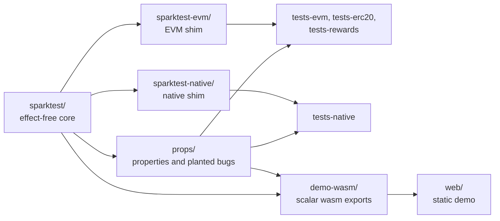

# Sparktest

Property testing for Fe: find the input that breaks your code, shrink it, replay it.

**[Live demo](https://ajkadri.github.io/sparktest-fe/)** (the properties run in your browser as compiled Fe, via WebAssembly).

**Try it in one minute:** open the demo, pick a property (for example *Buggy sort*), press **Run**, watch the first counterexample shrink step by step to the smallest input that still fails, then press **Replay** to reproduce the same failure from the same seed.

## The problem

Unit tests check the inputs you thought of. The bugs that cost money tend to sit elsewhere: rounding at the edge of a vault, an overflow at a large amount, a state you reach only after several calls. Property-based testing states a rule ("depositing and withdrawing never returns more than you put in") and lets the tool search for the input that breaks it.

- Trail of Bits studied 246 findings from 23 of its own audits ([arXiv:1911.07567](https://arxiv.org/pdf/1911.07567)). The authors estimate that 37% of all findings (91 of 246) and 63% of the high-severity, low-difficulty ones (17 of 27) were plausibly detectable with user-defined properties. These are the authors' optimistic estimates from one company's audits, not measured detection rates.
- Share-rounding in ERC-4626 vaults is a documented attack surface: OpenZeppelin's guide has a "Security concern: Inflation attack" section built on how deposits round ([docs](https://docs.openzeppelin.com/contracts/erc4626)).
- Solidity has fuzzers (Echidna, Foundry). Fe had no property-testing library; this is one, written in Fe.

## Before / after

A vault mints shares for deposits. The share calculation rounds up, which pays the depositor too much:

```fe-excerpt
fn shares_for_deposit(_ amount: u128, _ assets: u128, _ shares: u128) -> u128 {
    (amount * shares + assets - 1) / assets            // BUG: should be amount * shares / assets
}
```

Three unit tests with round numbers all pass:

```fe-excerpt
#[test]
fn deposit_into_a_one_to_one_vault() {
    assert!(shares_for_deposit(100, 1000, 1000) == 100)
}
```

One Sparktest property (the other two unit tests are in [`examples/quickstart`](examples/quickstart/src/lib.fe)) finds the bug and shrinks it to the smallest vault that shows it, 3 assets, 1 share, a deposit of 1:

```fe-excerpt
// deposit `amount` into a vault holding (assets, shares), then withdraw the minted shares: you must never get back more than you put in
fn deposit_then_withdraw_never_profits(_ p: (u32, u32, u32)) -> bool {
    let assets = p.0 as u128
    let shares = p.1 as u128
    let amount = p.2 as u128
    if assets == 0 || shares == 0 || amount == 0 { return true }
    let minted = shares_for_deposit(amount, assets, shares)
    assets_for_shares(minted, assets + amount, shares + minted) <= amount
}
```

```fe-excerpt
#[test]
fn sparktest_finds_the_bug_and_shrinks_it() uses (evm: mut Evm) {
    match check(Config::new(fixed_seed(2)), deposit_then_withdraw_never_profits) {
        Outcome::Pass { cases: _ } => { assert!(false) }
        Outcome::Fail { original: _, shrunk, case: _, seed: _, steps: _ } => {
            // the smallest vault where rounding up pays the depositor: 3 assets, 1 share, deposit 1
            assert!(shrunk.0 == 3 && shrunk.1 == 1 && shrunk.2 == 1)
        }
    }
}
```

## Quickstart

The ingot [`examples/quickstart`](examples/quickstart) consumes Sparktest exactly as described here, and `./scripts/test-all.sh` runs it.

**1. Add the dependency** to your `fe.toml`. A path dependency (tested; the ingot names use underscores):

```toml
[dependencies]
sparktest = { path = "../sparktest" }
sparktest_evm = { path = "../sparktest-evm" }   # EVM shim: assert_holds, seeds
```

Fe 26.7.0 also accepts a git dependency (`source`, `rev`, and `path` for the subdirectory of the ingot). I tested this form against a `file://` URL of this repository (both `sparktest` and `sparktest_evm` resolved and ran a property); the same syntax with the GitHub URL has not been tested until the repository is published:

```toml
[dependencies]
sparktest = { source = "https://github.com/ajkadri/sparktest-fe", rev = "<commit hash>", path = "sparktest" }
sparktest_evm = { source = "https://github.com/ajkadri/sparktest-fe", rev = "<commit hash>", path = "sparktest-evm" }
```

**2. Write a property**: a function from one input to `bool` that returns `true` when the rule holds. The input can be any type with a generator (`u8` to `u256`, `Address`, tuples, arrays, `Index<N>`, `Seq<C, N>`, or your own struct; see [docs/API.md](docs/API.md)).

**3. Run it** with `fe test`. `assert_holds` fails the test with a `PropertyFailed` revert carrying the seed and the shrunk input; `check` returns an `Outcome` you can inspect:

```fe-excerpt
#[test(should_revert, selector = 0x4c350703)]
fn assert_holds_reverts_with_the_shrunk_input() uses (evm: mut Evm) {
    assert_holds(check(Config::new(fixed_seed(2)), deposit_then_withdraw_never_profits))
}
```

**4. Read the failure.** Without the `should_revert` wrapper the test fails like this (the runner prints the revert data in hex; `tools/decode-revert` decodes it):

```
FAIL  assert_holds_reverts_with_the_shrunk_input
    Test reverted: 0x4c3507030000000000000000000000000000000000000000000000015eed5eed5eed5eef…

$ node tools/decode-revert/decode.mjs 0x4c350703…
selector  0x4c350703  (PropertyFailed(uint256,uint256,uint256,uint256[]))
seed      25286971856348077807  (0x15eed5eed5eed5eef)
case      3 (index 2)
steps     178
input     3 word(s): [3, 1, 1]
```

**5. Replay the seed**: pass the reported seed to `Config::new` and the same failure comes back, with the same case and shrink steps:

```fe-excerpt
#[test]
fn replay_from_the_seed_in_the_failure_report() {
    match check(Config::new(25286971856348077807), deposit_then_withdraw_never_profits) {
        Outcome::Pass { cases: _ } => { assert!(false) }
        Outcome::Fail { original: _, shrunk, case, seed: _, steps } => {
            assert!(case == 2 && steps == 178)   // "case 3 (index 2)" and "steps 178" in the report
            assert!(shrunk.0 == 3 && shrunk.1 == 1 && shrunk.2 == 1)
        }
    }
}
```

Shrinking is greedy, so it stops at a local minimum. Over seeds 1 to 12 on this property, 10 reach (3, 1, 1) and 2 stop at other tiny single-share vaults ((18, 1, 271) and (8, 1, 41)); the quickstart test `most_seeds_reach_the_smallest_vault` records this.

## Features

- **Generators**: `u8`, `u16`, `u32`, `u64`, `u128`, `u256`, `bool`, `Address`, tuples of 2 to 4, fixed arrays `[T; N]` (generic over element type and length), `Index<N>` (a value in 0..N-1 for picking from a small set) and `Seq<C, N>` (a sequence of up to N commands). User structs work by delegating to a tuple of their fields.
- **Edge bias**: about 1 draw in 4 is an edge value (0, 1, 2, max, max-1, 2^k, 2^k-1, 2^k+1), the rest are uniform.
- **Shrinking**: greedy, per type (integers toward 0, sequences shorter first, then simpler commands).
- **Seeds and replay**: every failure reports its seed; the same seed gives the same failure on every backend.
- **Checked helpers**: `checked_add`, `checked_sub`, `checked_mul` for `u8` to `u256`, returning `Option`, so an overflow inside a property is a reported failure instead of a panic.
- **Contract testing**: properties can call deployed contracts; through `evm.try_call` a contract panic becomes a failed call that is found and shrunk.
- **Panic recovery**: a property whose code panics (overflow, division by zero) is reported with its reason and shrunk: through a harness contract and `try_call` on sonatina, by bisect-and-replay on native and wasm.
- **Vacuity guards**: a property records its calls and command kinds in a `Tally` (an effect), and `guard` reports a passing run that never exercised its premise (no call succeeded, or a command kind never ran) as vacuous instead of as a pass.
- **Stateful testing**: random command sequences, an invariant checked after every command, failing sequences shrunk to the shortest.
- **Three backends**: sonatina (the EVM test backend), native, and WebAssembly (the demo).

## What is Fe-specific

Each claim below is backed by a check in this repository; the spike reports record the compiler output ([spike/SPIKE_REPORT.md](spike/SPIKE_REPORT.md), [spike/SPIKE2_REPORT.md](spike/SPIKE2_REPORT.md)).

- **An effect-polymorphic runner.** `check` is declared `uses P::E`, so a property that needs an effect (for example `Evm`) is accepted when its caller provides it; a runner that omits `uses P::E` is rejected (`error[8-0106]: missing effect row 'P::E' required by 'call'`). Spike 2, check E5.
- **An effect-free core with per-backend shims.** A test's entry effect is `Evm` on sonatina and `Host` on native, so one file cannot mix them (`error[8-0153]: unsupported entry effect`). The core (`sparktest/`) has no effects; `sparktest-evm/` and `sparktest-native/` are thin shims, and test ingots are separate. Spike 1 check D, spike 2 check E6.
- **Generic traits, including const-generic arrays.** `Arbitrary`, `Shrink` and `Encode` are implemented generically for tuples and `[T; N]`, and `Seq<C, N>` builds on them. Spike 2, check E3; `sparktest/src/composite.fe`.
- **A revert as a value.** Through `evm.try_call` a panicking contract call comes back as a result; through a direct `evm.call` the panic bubbles up and ends the whole test with no report. Both are shown side by side in [docs/PROOF.md](docs/PROOF.md) (the `examples/rewards` section).
- **Cross-backend determinism as a compiler check.** The same seed gives identical results on sonatina and native, and on wasm in the demo, so a disagreement between backends is a finding. `scripts/cross-check.sh` compares 11 scenarios (11/11 identical), and the demo test compares all six demo properties.

## Proof

[docs/PROOF.md](docs/PROOF.md) is generated by `./scripts/proof.sh`. Expected minimums were written down before running, in [docs/EXPECTATIONS.md](docs/EXPECTATIONS.md) (commits [`95fa0e8`](https://github.com/ajkadri/sparktest-fe/commit/95fa0e8), [`de453d8`](https://github.com/ajkadri/sparktest-fe/commit/de453d8) and [`07bed4d`](https://github.com/ajkadri/sparktest-fe/commit/07bed4d), each before the runs it covers).

| area | what was tested | result |
|---|---|---|
| planted bugs (pure code, sonatina and native) | vault rounding, fee overflow, balance underflow, packing shift, bounds off-by-one; each with a fixed version | 5 of 5 bugs found and shrunk (vault to 3 assets, 1 share, deposit 1; withdraw to balance 0, amount 1; pack to a=1, b=0; bounds to i=0, len=0); 5 of 5 fixed versions pass 256 cases; both backends identical |
| ERC20 through contract calls (sonatina) | the ERC20 test fixture from the Fe compiler repo (`crates/fe/tests/fixtures/fe_test/erc20.fe` at e6e6342), 4 actor contracts, 64 cases per property | 6 of 6 properties hold on the unchanged fixture; a planted self-transfer bug is caught by 2 properties, both shrunk to exactly (0, 0, 1) with `Index<4>` actors (with raw `u8` actors, 1 of the 2 stops at (1, 1, 1); before joint shrinking one `Index<4>` result stopped at (3, 3, 1)) |
| the Fe Guide's ERC-20 and a mutation test (sonatina) | the "Complete ERC20" example from https://fe-lang.org/examples/erc20/ (vendored unchanged), the 6 ERC20 properties and the stateful model check, then 10 single-change mutants | all 7 checks pass on the unchanged contract (none vacuous); 8 of 10 mutants caught, 2 missed with a probe-backed explanation each (an equivalent mutant, a dropped event); M10 (no MINTER check) was missed until the stateful command set got a Mint from any actor, and is now caught; 7 of 10 matched the pre-registered expectation exactly, 3 partly (M03 and M04 are now caught by P4 only: the stateful check lost power with a fifth command kind; M09 caught by more than the stateful run) |
| panic recovery (sonatina, native, wasm) | a property that overflows (`u64`), one that divides by zero, and a normal false-returning one, through `check_isolated`, `scripts/find-panic.sh` and the demo page | overflow shrunk to exactly 18446744073709552 and division by zero to (0, 0), each with the panic reason; the false-returning property gives the same result as `check`; first case, shrink steps and shrunk input identical on sonatina and native, and on wasm for the overflow property; one isolated evaluation costs about 1,500 gas |
| a contract that panics (sonatina) | `examples/rewards`, overflow in `claim` | through `try_call`: found and shrunk to exactly 18446744073709552, the smallest overflowing stake; through a direct call the whole test reverts with Panic(0x11) and reports nothing |
| stateful (sonatina and native; ERC20 on sonatina) | a bank model with a bug that needs three commands; the ERC20 fixture vs a reference model, with a planted bug that needs two calls | bank bug shrunk to 3 commands, identical on both backends; ERC20 planted bug shrunk to 2 calls (found on case 102; 64 cases no longer find it since the command set has five kinds, so that run uses 128); the unchanged fixture passes 64 cases |
| std (sonatina and native) | integer wrapping/saturating ops, `mul_div`, `addmod`, `isqrt`, `core::sort`, the std ABI codec round trip | 12 of 12 properties hold; no Fe bug found by them |

## Architecture



The core defines the traits, generators, shrinking, `check`, `Index`, `Seq` and the checked helpers. Shims adapt failure reporting to a backend. Details: [docs/ARCHITECTURE.md](docs/ARCHITECTURE.md); every public item: [docs/API.md](docs/API.md).

## Reproduce everything

Tested on macOS (Apple Silicon) only. You need Fe 26.7.0, Node 20 or newer (tested with 24.15.0), Python 3 (standard library only) and git.

```bash
# 1. install Fe 26.7.0 (commit e6e6342)
curl -fsSL https://raw.githubusercontent.com/argotorg/fe/master/feup/feup.sh | bash -s -- --version v26.7.0
export PATH="$HOME/.fe/bin:$PATH"
fe --version          # fe 26.7.0 (e6e6342)

# 2. get the code and run everything
git clone https://github.com/ajkadri/sparktest-fe.git
cd sparktest-fe
./scripts/test-all.sh   # exit code 0 when every part passes; about a minute on the machine used for this README
```

`test-all.sh` runs these parts and prints `ALL PARTS PASSED` at the end (counts from the last run):

```
tests-evm (sonatina)                    93 passed
tests-native (native)                   65 passed
decode-revert (node)                    all decode-revert tests passed
cross-check (sonatina vs native)        CROSS-CHECK: IDENTICAL (11/11)
erc20 (sonatina only)                   vendored bodies byte-identical to upstream; 1 + 28 passed
coolcoin (sonatina only)                3 + 83 passed (the Guide ERC-20 and 10 mutants)
rewards (sonatina only)                 3 passed
quickstart example                      8 passed
docs                                    README excerpts verbatim; 24 + 1 API examples compiled and passed
proof suites                            proof: all expectations met and docs/PROOF.md is current
isolated (sonatina)                     5 passed (panic recovery through a harness contract)
web demo                                all 6 demo properties agree across wasm, sonatina (EVM) and native
evm recordings are current              Expected failures: 4/4 recorded
freshness (generated files)             PART OK
ALL PARTS PASSED
```

Other commands:

```bash
./scripts/proof.sh                   # rerun the proof suites and regenerate docs/PROOF.md (--check verifies without writing)
./scripts/record-evm.sh              # re-record the sonatina runs shown in the demo's "Recorded on EVM" panel (--check verifies)
./scripts/build-demo.sh              # rebuild the demo's wasm and props.json
cd web && python3 -m http.server 8765   # serve the demo at http://localhost:8765/ (local run)
```

## Limitations

- Shrinking is greedy and finds a local minimum, not always the smallest input. After the one-component moves a tuple, array or sequence also tries three joint moves (all components together, groups of equal components together, moving an amount from an earlier slot to a later one), each only if it is strictly simpler; coupled components that none of these moves reaches still stop early. Example: the ERC20 self-transfer bug with raw `u8` actors stops at (1, 1, 1), because equal values are grouped by value and the amount 1 is in the same group as the two indices. Joint candidates are capped at 400 per step, and joint shrinking multiplies the gas of a failing run (the planted bank bug costs about 20 times more gas to shrink).
- With plain `check`, a property must not panic: a panic inside it ends the whole test with no report (use the checked helpers for arithmetic). Panics are recovered by new paths instead: on sonatina `check_isolated` runs each evaluation inside a harness contract through `try_call` (you write the harness: one contract, one line per property, because Fe contracts cannot be generic); on native `scripts/find-panic.sh` bisects to the first aborting case and shrinks by replay; the demo page does the same for a wasm trap. Not covered: properties that loop forever or run out of gas, panics in the generator or shrinker, `Seq` inputs on the isolated path (no `Decode` for `Seq`), and native recovery inside a test (it is a script around a separate executable). Details: [docs/DESIGN-panic-recovery.md](docs/DESIGN-panic-recovery.md).
- Contract testing needs the EVM test backend (sonatina); native and wasm test pure code.
- A guard only knows what a property records: calls and command kinds must be reported to the `Tally`, and the vacuity check does not judge whether a premise is strong enough (for example 7 of 64 transfers succeed in one ERC20 property; that is reported, not flagged).
- The web demo's inputs are at most 64 bits (they cross the wasm boundary as scalars), and its properties are prebuilt: the page cannot compile your own Fe.
- Sonatina tests have a 1,000,000,000 gas cap per test (a simple loop costs about 145 gas per case, so roughly 6.8 million cases fit).
- Fe 26.x is not production-ready, and Sparktest is work in progress.
- The std properties found no bug, so they show Sparktest running on real code, not that it finds std bugs.
- The ERC20 contract is a compiler test fixture, not a production token; it returns `false` instead of reverting on a shortfall, and `mint` is open to anyone (observations, not bugs).

## Fe bugs found and reported

- [argotorg/fe#2066](https://github.com/argotorg/fe/issues/2066): `Type::assoc_fn()` fails for a user trait implemented on `std::evm::Address` (minimal repro: `spike/repros/e7a_static_trait_call.fe`; workaround: `<Address as Trait>::f`).
- [argotorg/fe#2067](https://github.com/argotorg/fe/issues/2067): `println!` with an untyped integer literal fails type inference (repro: `spike/repros/e7b_println_untyped_literal.fe`).
- [argotorg/fe#2035](https://github.com/argotorg/fe/issues/2035): an existing report that unknown attributes are accepted silently. Related behaviour seen here: unknown keys inside `#[test(...)]` are also accepted silently (spike 2, check E4).

## Roadmap

Planned, not implemented: signed integers (they exist in Fe 26.7.0), more std and contract examples, and tagged releases so the git dependency can pin a version.

## License

Licensed under either of Apache License 2.0 or MIT license at your option. See [LICENSE-APACHE](LICENSE-APACHE) and [LICENSE-MIT](LICENSE-MIT).
