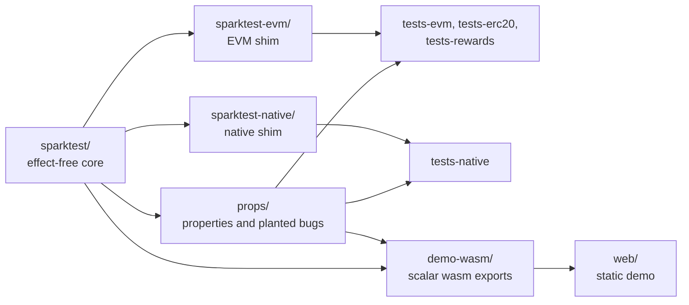

# Sparktest

[](https://github.com/AjKadri/sparktest-fe/actions/workflows/ci.yml)

**Pitch:** Sparktest is a property-testing library written in Fe: you state a rule, and it searches for the input that breaks it in plain values, contract calls and call sequences, shrinks the failure to a minimal case (even when the code panics) and replays it from a seed, on the EVM, natively and in the browser.

**[Live demo](https://ajkadri.github.io/sparktest-fe/)** (the properties run in your browser as compiled Fe, via WebAssembly).

**Try it in one minute:** open the demo, pick a property (for example *Buggy sort*), press **Run**, watch the first counterexample shrink step by step to the smallest input that still fails, then press **Replay** to reproduce the same failure from the same seed.

## The problem

Unit tests check the inputs you thought of. The bugs that cost money tend to sit elsewhere: rounding at the edge of a vault, an overflow at a large amount, a state you reach only after several calls. Property-based testing states a rule ("depositing and withdrawing never returns more than you put in") and lets the tool search for the input that breaks it.

- Trail of Bits studied 246 findings from 23 of its own audits ([arXiv:1911.07567](https://arxiv.org/pdf/1911.07567)). The authors estimate that 37% of all findings (91 of 246) and 63% of the high-severity, low-difficulty ones (17 of 27) were plausibly detectable with user-defined properties. These are the authors' optimistic estimates from one company's audits, not measured detection rates.
- Share-rounding in ERC-4626 vaults is a documented attack surface: OpenZeppelin's guide has a "Security concern: Inflation attack" section built on how deposits round ([docs](https://docs.openzeppelin.com/contracts/erc4626)).
- Solidity has fuzzers (Echidna, Foundry). Fe's built-in test runner has no property testing.

## Approach

Sparktest was built during the contest (22 to 24 November 2026): two feasibility spikes first, then one bounded step at a time, each with its expected results written down before it was run ([docs/EXPECTATIONS.md](docs/EXPECTATIONS.md)). The design, in a few bullets:

- **Generators with edge bias.** One `Arbitrary` implementation per type; about 1 draw in 4 is an edge value (0, 1, 2, max, 2^k and its neighbours).
- **Shrinking.** Greedy: the first simpler candidate that still fails is taken. Component candidates run to a fixed point, then joint candidates (all components together, equal components together, moving an amount to a later slot) as a finishing pass, repeated while anything improves.
- **Seeds and replay.** Every failure reports its seed; the same numeric seed gives identical results on every backend (`scripts/cross-check.sh` compares them). Some test suites deliberately use backend-specific `fixed_seed`s, so their individual runs differ.
- **Checked helpers.** `checked_add`, `checked_sub`, `checked_mul` return `Option`, so an overflow inside a property is a reported failure.
- **Contract testing.** Properties call deployed contracts through actor contracts and `evm.try_call`, so a contract panic becomes a failed call that is found and shrunk.
- **Panic recovery.** `check_isolated` runs each evaluation inside a harness contract (sonatina); bisect-and-replay does the same on native and wasm.
- **Stateful testing.** `Seq<C, N>` generates and shrinks command sequences; an invariant is checked after every command.
- **Vacuity guards.** A property records its calls in a `Tally`; a pass that never exercised its premise is reported as vacuous.
- **Gas-safe shrinking.** `sparktest_evm::check_gas` stops shrinking before the gas cap and reports the best input so far with an `early` flag.
- **Three backends.** sonatina (the EVM test backend), native, and WebAssembly (the demo); results are compared across them.

## Before / after

A vault mints shares for deposits. The share calculation rounds up, which pays the depositor too much:

```fe-excerpt
fn shares_for_deposit(_ amount: u128, _ assets: u128, _ shares: u128) -> u128 {
    (amount * shares + assets - 1) / assets // BUG: should be amount * shares / assets
}
```

Three unit tests with round numbers all pass:

```fe-excerpt
#[test]
fn deposit_into_a_one_to_one_vault() {
    assert!(shares_for_deposit(100, 1000, 1000) == 100)
}
```

One Sparktest property (the other two unit tests are in [`examples/quickstart`](examples/quickstart/src/lib.fe)) finds the bug and shrinks it to the smallest vault that shows it, 3 assets, 1 share, a deposit of 1:

```fe-excerpt
// deposit `amount` into a vault holding (assets, shares), then withdraw the minted shares: you must never get back more than you put in
fn deposit_then_withdraw_never_profits(_ p: (u32, u32, u32)) -> bool {
    let assets = p.0 as u128
    let shares = p.1 as u128
    let amount = p.2 as u128
    if assets == 0 || shares == 0 || amount == 0 {
        return true
    }
    let minted = shares_for_deposit(amount, assets, shares)
    assets_for_shares(minted, assets + amount, shares + minted) <= amount
}
```

```fe-excerpt
#[test]
fn sparktest_finds_the_bug_and_shrinks_it() uses (evm: mut Evm) {
    match check(
        Config::new(fixed_seed(2)),
        deposit_then_withdraw_never_profits,
    ) {
        Outcome::Pass { cases: _ } => {
            assert!(false)
        },
        Outcome::Fail { original: _, shrunk, case: _, seed: _, steps: _, early: _ } => {
            // the smallest vault where rounding up pays the depositor: 3 assets, 1 share, deposit 1
            assert!(shrunk.0 == 3 && shrunk.1 == 1 && shrunk.2 == 1)
        },
    }
}
```

## Quickstart

The ingot [`examples/quickstart`](examples/quickstart) consumes Sparktest exactly as described here, and `./scripts/test-all.sh` runs it.

**1. Add the dependency** to your `fe.toml`. A path dependency (tested; the ingot names use underscores):

```toml
[dependencies]
sparktest = { path = "../sparktest" }
sparktest_evm = { path = "../sparktest-evm" }   # EVM shim: assert_holds, seeds
```

Fe 26.7.0 also accepts a git dependency (`source`, `rev`, and `path` for the subdirectory of the ingot). Pinned to the v0.1.0 tag (verified with `./scripts/check-git-dep.sh`).

```toml
[dependencies]
sparktest = { source = "https://github.com/AjKadri/sparktest-fe", rev = "v0.1.0", path = "sparktest" }
sparktest_evm = { source = "https://github.com/AjKadri/sparktest-fe", rev = "v0.1.0", path = "sparktest-evm" }
```

**2. Write a property**: a function from one input to `bool` that returns `true` when the rule holds. The input can be any type with a generator (`u8` to `u256`, `Address`, tuples, arrays, `Index<N>`, `Seq<C, N>`, or your own struct; see [docs/API.md](docs/API.md)).

**3. Run it** with `fe test`. `assert_holds` fails the test with a `PropertyFailed` revert carrying the seed and the shrunk input; `check` returns an `Outcome` you can inspect:

```fe-excerpt
#[test(should_revert, selector = 0x4c350703)]
fn assert_holds_reverts_with_the_shrunk_input() uses (evm: mut Evm) {
    assert_holds(
        check(
            Config::new(fixed_seed(2)),
            deposit_then_withdraw_never_profits,
        ),
    )
}
```

**4. Read the failure.** Without the `should_revert` wrapper the test fails like this (the runner prints the revert data in hex; `tools/decode-revert` decodes it):

```
FAIL  assert_holds_reverts_with_the_shrunk_input
    Test reverted: 0x4c3507030000000000000000000000000000000000000000000000015eed5eed5eed5eef…

$ node tools/decode-revert/decode.mjs 0x4c350703…
selector  0x4c350703  (PropertyFailed(uint256,uint256,uint256,uint256[]))
seed      25286971856348077807  (0x15eed5eed5eed5eef)
case      3 (index 2)
steps     178
input     3 word(s): [3, 1, 1]
```

**5. Replay the seed**: pass the reported seed to `Config::new` and the same failure comes back, with the same case and shrink steps:

```fe-excerpt
#[test]
fn replay_from_the_seed_in_the_failure_report() {
    match check(
        Config::new(25286971856348077807),
        deposit_then_withdraw_never_profits,
    ) {
        Outcome::Pass { cases: _ } => {
            assert!(false)
        },
        Outcome::Fail { original: _, shrunk, case, seed: _, steps, early: _ } => {
            assert!(
                case == 2 && steps == 178,
            ) // "case 3 (index 2)" and "steps 178" in the report
            assert!(shrunk.0 == 3 && shrunk.1 == 1 && shrunk.2 == 1)
        },
    }
}
```

Shrinking is greedy, so it stops at a local minimum. Over seeds 1 to 12 on this property, 10 reach (3, 1, 1) and 2 stop at other tiny single-share vaults ((18, 1, 271) and (8, 1, 41)); the quickstart test `most_seeds_reach_the_smallest_vault` records this.

**6. Custom generators.** When a property needs inputs that satisfy a rule, give `check_gen` a generator instead of filtering or wrapping a raw number. Here the vault's three inputs are drawn inside their ranges, so the property needs no `== 0` guards, and shrinking never leaves a range: the same bug shrinks to the same smallest vault. `dependent(a, f)` draws a second value from a generator built from the first (see [docs/API.md](docs/API.md)); `Judged::Discard` drops cases whose premise fails and reports the discard rate.

```fe-excerpt
// the same bug with a custom generator: assets and shares in 1..=1000, the deposit in 1..=100, so the property needs no `== 0` guards
fn never_profits_in_range(_ v: ((u256, u256), u256)) -> bool {
    let assets: u128 = v.0.0.downcast_truncate()
    let shares: u128 = v.0.1.downcast_truncate()
    let amount: u128 = v.1.downcast_truncate()
    let minted = shares_for_deposit(amount, assets, shares)
    assets_for_shares(minted, assets + amount, shares + minted) <= amount
}

#[test]
fn a_custom_generator_finds_the_same_vault_inside_its_ranges()
uses (evm: mut Evm)
{
    let g = pair(pair(between(1, 1000), between(1, 1000)), between(1, 100))
    match check_gen(Config::new(fixed_seed(2)), g, never_profits_in_range) {
        Outcome::Pass { cases: _ } => {
            assert!(false)
        },
        Outcome::Fail { original: _, shrunk, case: _, seed: _, steps: _, early: _ } => {
            // never below a range's lower bound: 3 assets, 1 share, a deposit of 1
            assert!(shrunk.0.0 == 3 && shrunk.0.1 == 1 && shrunk.1 == 1)
        },
    }
}
```

## Features

- **Generators**: `u8`, `u16`, `u32`, `u64`, `u128`, `u256`, `bool`, `Address`, tuples of 2 to 4, fixed arrays `[T; N]` (generic over element type and length), `Index<N>` (a value in 0..N-1 for picking from a small set) and `Seq<C, N>` (a sequence of up to N commands). User structs work by delegating to a tuple of their fields.
- **Edge bias**: about 1 draw in 4 is an edge value (0, 1, 2, max, max-1, 2^k, 2^k-1, 2^k+1), the rest are uniform.
- **Shrinking**: greedy, per type (integers toward 0, sequences shorter first, then simpler commands), then joint candidates for coupled components.
- **Seeds and replay**: every failure reports its seed; the same numeric seed gives identical results on every backend (`scripts/cross-check.sh`). Some test suites deliberately use backend-specific `fixed_seed`s, so their individual runs differ.
- **Checked helpers**: `checked_add`, `checked_sub`, `checked_mul` for `u8` to `u256`, returning `Option`, so an overflow inside a property is a reported failure instead of a panic.
- **Contract testing**: properties can call deployed contracts; through `evm.try_call` a contract panic becomes a failed call that is found and shrunk.
- **Panic recovery**: a property whose code panics (overflow, division by zero) is reported with its reason and shrunk: through a harness contract and `try_call` on sonatina, by bisect-and-replay on native and wasm.
- **Custom generators**: a `Gen` trait (generate, shrink inside the domain, `contains`) with `between(lo, hi)`, `one_of`, `pair`, `dependent` ("an amount up to the balance") and `mapped`; `check_gen` runs a property over one, and a shrunk value never leaves the generator's domain.
- **Assume**: a property can return `Discard`; discards are counted, and a run that discarded more than 90% of its cases, or accepted none, is reported as vacuous.
- **Regression seeds**: `Config::with_regressions([seed, ...])` replays the seeds of earlier failures before the random cases and reports a failing one with its own seed.
- **Signed integers**: `i8` to `i256` are generated (edge values min, -1, 0, 1, max) and shrunk toward 0.
- **Vacuity guards**: a property records its calls and command kinds in a `Tally` (an effect), and `guard` reports a passing run that never exercised its premise (no call succeeded, or a command kind never ran) as vacuous instead of as a pass.
- **Stateful testing**: random command sequences, an invariant checked after every command, failing sequences shrunk to the shortest.
- **Three backends**: sonatina (the EVM test backend), native, and WebAssembly (the demo).
- **Gas-safe shrinking** (EVM): `check_gas` stops shrinking while gas remains and reports the best input so far with an `early` flag instead of ending in `OutOfGas`.

## Fe highlight

**An effect-polymorphic runner that carries a `Tally` from a property to its caller.** `check` is declared `uses P::E`: whatever effects the property closure needs become effects of `check` itself, so the same runner accepts a pure property, a property that calls contracts (`Evm`) and a property that records into a `Tally`. The core has no effects of its own. Below, the property declares `uses (tally: mut Tally)`, and the test provides the `Tally` with `with (mut tally) { ... }` around `check`; afterwards the test reads what the property recorded (`examples/quickstart/src/lib.fe`):

```fe-excerpt
fn deposit_is_recorded(_ amount: u32) -> bool uses (tally: mut Tally) {
    tally.call(amount > 0)
    shares_for_deposit(amount as u128 + 1, 1000, 1000) >= amount as u128
}

#[test]
fn the_tally_travels_from_the_property_to_its_caller() uses (evm: mut Evm) {
    var tally = Tally::new()
    let cfg = Config::new(fixed_seed(5)).with_cases(64)
    let o = with (mut tally) {
        check(cfg, deposit_is_recorded)
    }
    assert!(summarize(o).failed == 0 && vacuity(tally, true, 0) == 0)
}
```

A runner that omits `uses P::E` is rejected: `error[8-0106]: missing effect row 'P::E' required by 'call'` (spike 2, check E5). The other Fe-specific points, each backed by a check in this repository (the spike reports record the compiler output: [spike/SPIKE_REPORT.md](spike/SPIKE_REPORT.md), [spike/SPIKE2_REPORT.md](spike/SPIKE2_REPORT.md)):

- **An effect-free core with per-backend shims.** A test's entry effect is `Evm` on sonatina and `Host` on native, so one file cannot mix them (`error[8-0153]: unsupported entry effect`). The core (`sparktest/`) has no effects; `sparktest-evm/` and `sparktest-native/` are thin shims, and test ingots are separate. Spike 1 check D, spike 2 check E6.
- **Generic traits, including const-generic arrays.** `Arbitrary`, `Shrink` and `Encode` are implemented generically for tuples and `[T; N]`, and `Seq<C, N>` builds on them. Spike 2, check E3; `sparktest/src/composite.fe`.
- **A revert as a value.** Through `evm.try_call` a panicking contract call comes back as a result (and `check_isolated` builds on it); through a direct `evm.call` the panic bubbles up and ends the whole test with no report. Both are shown side by side in [docs/PROOF.md](docs/PROOF.md) (the `examples/rewards` section).
- **Cross-backend determinism as a compiler check.** The same numeric seed gives identical results on sonatina and native, and on wasm in the demo, so a disagreement between backends is a finding. (Some test suites deliberately use backend-specific `fixed_seed`s, so their individual runs differ; the comparison is made with explicit seeds.) `scripts/cross-check.sh` compares 11 scenarios (11/11 identical), and the demo test compares all six demo properties.

## Architecture



The repository root has a `fe.toml` workspace of the sonatina (EVM) ingots (see Build and test). The core defines the traits, generators, shrinking, `check`, `Index`, `Seq` and the checked helpers. Shims adapt failure reporting to a backend. Details: [docs/ARCHITECTURE.md](docs/ARCHITECTURE.md); every public item: [docs/API.md](docs/API.md).

## Build and test

Tested on macOS (Apple Silicon) locally and on Linux in CI (GitHub Actions, ubuntu-latest). You need Fe 26.7.0, Node 20 or newer (tested with 24.15.0), Python 3 (standard library only; tested with 3.9.6) and git.

```bash
# 1. install Fe 26.7.0 (commit e6e6342)
curl -fsSL https://raw.githubusercontent.com/argotorg/fe/master/feup/feup.sh | bash -s -- --version v26.7.0
export PATH="$HOME/.fe/bin:$PATH"
fe --version          # fe 26.7.0 (e6e6342)

# 2. get the code
git clone https://github.com/AjKadri/sparktest-fe.git
cd sparktest-fe

# 3. check and test at the repository root
fe check              # no output, exit code 0
fe test               # test result: ok. 329 passed; 0 failed

# 4. run every part of the suite
./scripts/test-all.sh   # exit code 0 when every part passes
```

The root `fe.toml` is a workspace of the sonatina (EVM) ingots: the library, its EVM shim, the properties, the ERC20 and CoolCoin suites, and the quickstart. The native test ingot is not a member, because a workspace cannot mix targets (with it, `fe check` fails with `error[8-0153]: unsupported entry effect`); run it with `cd tests-native && fe test`, and the rest with `./scripts/test-all.sh`. `fe build` has no contracts to build in a library, so it is not used here; `fe check` is the compile check. The first-party code is formatted with `fe fmt` (the vendored upstream files and the generated mutants are left as they are), and `test-all.sh` checks it with `fe fmt --check`.

`test-all.sh` runs these parts and prints `ALL PARTS PASSED` at the end (counts from the last run):

```
tests-evm (sonatina)                    155 passed
tests-native (native)                   118 passed
decode-revert (node)                    all decode-revert tests passed
cross-check (sonatina vs native)        CROSS-CHECK: IDENTICAL (11/11)
erc20 (sonatina only)                   vendored bodies byte-identical to upstream; 1 + 32 passed
coolcoin (sonatina only)                3 + 120 passed (the Guide ERC-20, 10 mutants, 5 held-out mutants)
rewards (sonatina only)                 3 passed
quickstart example                      10 passed
docs                                    README excerpts verbatim; 34 + 1 API examples compiled and passed
proof suites                            proof: all expectations met and docs/PROOF.md is current
isolated (sonatina)                     5 passed (panic recovery through a harness contract)
web demo                                all 6 demo properties agree across wasm, sonatina (EVM) and native
evm recordings are current              Expected failures: 4/4 recorded
format (fe fmt --check)                 fe fmt --check: all first-party ingots are formatted
freshness (generated files)             PART OK (regenerated, formatted, identical)
ALL PARTS PASSED
```

Other commands:

```bash
./scripts/proof.sh                   # rerun the proof suites and regenerate docs/PROOF.md (--check verifies without writing)
./scripts/record-evm.sh              # re-record the sonatina runs shown in the demo's "Recorded on EVM" panel (--check verifies)
./scripts/build-demo.sh              # rebuild the demo's wasm and props.json
./scripts/check-git-dep.sh           # check that the git dependency in the Quickstart resolves (needs the v0.1.0 tag on GitHub)
cd web && python3 -m http.server 8765   # serve the demo at http://localhost:8765/ (local run)
```

## Demo

Live: **https://ajkadri.github.io/sparktest-fe/** (a static page; to serve it locally: `cd web && python3 -m http.server 8765`).

What to click: pick one of the six properties (*Capped mint*, *Buggy sort*, *Pair sum*, *Saturating add*, *Bank sequence*, *Overflow panic*), press **Run**, and watch the counterexample shrink; **Skip animation** jumps to the end, **Random seed** tries another seed, **Replay** reproduces the failure from the same seed. *Saturating add* holds, and shows a pass. *Bank sequence* shrinks a list of commands.

The panic-recovery property is *Overflow panic*: its code overflows `u64` and traps in WebAssembly. The page catches the trap, bisects the case limit to find the first case that panics (8 steps), and shrinks by replay to exactly 18446744073709552 with the reason "arithmetic overflow".

Two kinds of result are labelled differently on the page. The counterexample and the shrink steps are computed live in your browser, by the compiled Fe running as WebAssembly. The panel "Recorded on EVM" is not computed there: it shows a run on the sonatina EVM backend that `./scripts/record-evm.sh` recorded at a stated commit (`./scripts/record-evm.sh --check` verifies it is current), and the page's build line says which commit and Fe version made it. The demo test (`node web/sparktest.test.mjs`, part of `test-all.sh`) checks that wasm, EVM and native agree on all six properties.

## Proof

[docs/PROOF.md](docs/PROOF.md) is generated by `./scripts/proof.sh`. Expected minimums were written down before running, in [docs/EXPECTATIONS.md](docs/EXPECTATIONS.md) (commits [`95fa0e8`](https://github.com/AjKadri/sparktest-fe/commit/95fa0e8), [`de453d8`](https://github.com/AjKadri/sparktest-fe/commit/de453d8) and [`07bed4d`](https://github.com/AjKadri/sparktest-fe/commit/07bed4d), each before the runs it covers; later sections up to L7d follow the same rule).

| area | what was tested | result |
|---|---|---|
| planted bugs (pure code, sonatina and native) | vault rounding, fee overflow, balance underflow, packing shift, bounds off-by-one; each with a fixed version | 5 of 5 bugs found and shrunk (vault to 3 assets, 1 share, deposit 1; withdraw to balance 0, amount 1; pack to a=1, b=0; bounds to i=0, len=0); 5 of 5 fixed versions pass 256 cases; both backends identical |
| ERC20 through contract calls (sonatina) | the ERC20 test fixture from the Fe compiler repo (`crates/fe/tests/fixtures/fe_test/erc20.fe` at e6e6342), 4 actor contracts, 64 cases per property | 6 of 6 properties hold on the unchanged fixture; a planted self-transfer bug is caught by 2 properties, both shrunk to exactly (0, 0, 1) with `Index<4>` actors (with raw `u8` actors, 1 of the 2 stops at (1, 1, 1); before joint shrinking one `Index<4>` result stopped at (3, 3, 1)) |
| the Fe Guide's ERC-20 and a mutation test (sonatina) | the "Complete ERC20" example from https://fe-lang.org/examples/erc20/ (vendored unchanged), the 6 ERC20 properties and the stateful model check, then 10 single-change mutants | all 7 checks pass on the unchanged contract (none vacuous); 8 of 10 mutants caught, 2 missed with a probe-backed explanation each (an equivalent mutant, a dropped event); M10 (no MINTER check) was missed until the stateful command set got a Mint from any actor, and is now caught; 7 of 10 matched the pre-registered expectation exactly, 3 partly (M03 and M04 are now caught by P4 only: the stateful check lost power with a fifth command kind; M09 caught by more than the stateful run) |
| generators, assume, regression seeds, signed (sonatina and native) | `between`, `one_of`, `pair`, `dependent`, `mapped` (shrinking stays in the domain, never below `lo`); a valid-transfer generator on the ERC20 fixture; discard counting with the vacuity verdict; a regression seed that fails on the buggy vault and passes on the fixed one; `i8` to `i256` | 32 tests pass on both backends; the valid-transfer property passes 64 of 64 calls on the unchanged fixture and finds the planted bug (shrunk to a self-transfer of 1); a weak premise discards 96% of 64 cases and is flagged vacuous, a premise that never holds is flagged with reason 2; the regression seed reproduces case 3, 178 shrink steps, (3, 1, 1) on both backends. Existing results are unchanged (gas moved by under 0.05% in all but one small row; see docs/EXPECTATIONS.md) |
| held-out mutants (sonatina) | five NEW single changes of the Guide ERC-20 written after the tests were frozen (allowance raised instead of lowered, `transferFrom` debiting the spender, `mint` off by one, `approve` under the wrong key, `burn` not lowering the supply), expectations committed before they ran | 4 of 5 caught, 5 of 5 as predicted; the miss is `burn`, which no property or command calls (a probe shows it is a real difference); reported separately from M01 to M10 |
| panic recovery (sonatina, native, wasm) | a property that overflows (`u64`), one that divides by zero, and a normal false-returning one, through `check_isolated`, `scripts/find-panic.sh` and the demo page | overflow shrunk to exactly 18446744073709552 and division by zero to (0, 0), each with the panic reason; the false-returning property gives the same result as `check`; first case, shrink steps and shrunk input identical on sonatina and native, and on wasm for the overflow property; one isolated evaluation costs about 1,500 gas |
| a contract that panics (sonatina) | `examples/rewards`, overflow in `claim` | through `try_call`: found and shrunk to exactly 18446744073709552, the smallest overflowing stake; through a direct call the whole test reverts with Panic(0x11) and reports nothing |
| stateful (sonatina and native; ERC20 on sonatina) | a bank model with a bug that needs three commands; the ERC20 fixture vs a reference model, with a planted bug that needs two calls | bank bug shrunk to 3 commands, identical on both backends; ERC20 planted bug shrunk to 2 calls (found on case 102; 64 cases no longer find it since the command set has five kinds, so that run uses 128); the unchanged fixture passes 64 cases |
| std (sonatina and native) | integer wrapping/saturating ops, `mul_div`, `addmod`, `isqrt`, `core::sort`, the std ABI codec round trip | 12 of 12 properties hold; no Fe bug found by them |
| std hunt (sonatina and native) | a stateful model test of `core::map::HashMap` (spread keys and keys that all hash alike, growth past the first capacity), 12 properties of `core::fixed` against a widened integer model, 8 round-trip and length laws of `core::text`, 5 properties of `std::evm::random` (sonatina only); expected results written before the runs | 27 properties pass on sonatina and 22 on native; no divergence, so no Fe bug found (one of my own properties was wrong first and was fixed; see docs/PROOF.md) |

## Limitations

- Shrinking is greedy and finds a local minimum, not always the smallest input. After the one-component moves a tuple, array or sequence also tries three joint moves (all components together, groups of equal components together, moving an amount from an earlier slot to a later one), each only if it is strictly simpler; coupled components that none of these moves reaches still stop early. Example: the ERC20 self-transfer bug with raw `u8` actors stops at (1, 1, 1), because equal values are grouped by value and the amount 1 is in the same group as the two indices. Joint candidates are capped at 400 per step and are tried only at the top level, after the component candidates reach a fixed point. Shrinking still costs gas: against before joint shrinking, a failing run costs about 1.0x (the planted bank bug) to 6.5x (the fee overflow) as much; on the EVM, `sparktest_evm::check_gas` stops shrinking when less than 50,000,000 gas remains and reports the best input so far with an `early` flag, so a failure keeps its report instead of ending in `OutOfGas`.
- With plain `check`, a property must not panic: a panic inside it ends the whole test with no report (use the checked helpers for arithmetic). Panics are recovered by new paths instead: on sonatina `check_isolated` runs each evaluation inside a harness contract through `try_call` (you write the harness: one contract, one line per property, because Fe contracts cannot be generic); on native `scripts/find-panic.sh` bisects to the first aborting case and shrinks by replay; the demo page does the same for a wasm trap. Not covered: properties that loop forever or run out of gas, panics in the generator or shrinker, `Seq` inputs on the isolated path (no `Decode` for `Seq`), and native recovery inside a test (it is a script around a separate executable). Details: [docs/DESIGN-panic-recovery.md](docs/DESIGN-panic-recovery.md).
- Generators: `between` and `one_of` produce `u256` values (cast with `downcast_truncate()` for narrower types); `dependent` and `pair` shrink one component at a time plus, for `dependent`, both together, but have no general joint shrink; regression seeds are not honoured by `check_assume`; signed values shrink one component at a time inside a tuple. A discarded case is not replaced, so a weak premise lowers the number of cases actually tested (the discard rate says by how much).
- Contract testing needs the EVM test backend (sonatina); native and wasm test pure code.
- A guard only knows what a property records: calls and command kinds must be reported to the `Tally`, and the vacuity check does not judge whether a premise is strong enough (for example only 7 of 64 transfers succeed in P3 on the unchanged fixture with `Index<4>` actors; that is reported, not flagged).
- The web demo's inputs are at most 64 bits (they cross the wasm boundary as scalars), and its properties are prebuilt: the page cannot compile your own Fe.
- Sonatina tests have a 1,000,000,000 gas cap per test (measured: 20,000 cases of a one-comparison property over `u64` used 5,879,339 gas, about 294 gas per case, so roughly 3.4 million such cases fit; real properties cost far more).
- Fe 26.x is not production-ready, and Sparktest is work in progress.
- The std properties found no bug, so they show Sparktest running on real code, not that it finds std bugs.
- The ERC20 contract is a compiler test fixture, not a production token; it returns `false` instead of reverting on a shortfall, and `mint` is open to anyone (observations, not bugs).

## Fe bugs found and reported

- [argotorg/fe#2066](https://github.com/argotorg/fe/issues/2066): `Type::assoc_fn()` fails for a user trait implemented on `std::evm::Address` (minimal repro: `spike/repros/e7a_static_trait_call.fe`; workaround: `<Address as Trait>::f`).
- [argotorg/fe#2067](https://github.com/argotorg/fe/issues/2067): `println!` with an untyped integer literal fails type inference (repro: `spike/repros/e7b_println_untyped_literal.fe`).
- [argotorg/fe#2035](https://github.com/argotorg/fe/issues/2035): an existing report that unknown attributes are accepted silently. Related behaviour seen here: unknown keys inside `#[test(...)]` are also accepted silently (spike 2, check E4).

## Roadmap

Not implemented (each is a limit found while building, not a plan):

- `check_gen` has no isolated variant: a generator-driven property that panics is not recovered on the EVM (`check_isolated` takes the built-in generators).
- `Seq` has no `Decode`, so it cannot be a component of a tuple input or go through `check_isolated`.
- A discarded case (`assume`) is not replaced, so a weak premise tests fewer cases than the budget; regression seeds are not honoured by `check_assume`.
- `between` and `one_of` produce `u256` values (narrower types need a cast), and joint shrinking sees a negative signed value as a large word.
- The stateful ERC20 command set has no Burn command, so a mutant that breaks `burn` is invisible (held-out mutant H05).

## Declaration

**Pre-existing work:** None. Development started on 22 November 2026 with the feasibility spikes in `spike/`. The first commit is `2da6e8e` ("Spike 1: checks A-F and report", 2026-11-22).

**Third-party code:**

- The ERC-20 test fixture from the Fe compiler repository (argotorg/fe, `crates/fe/tests/fixtures/fe_test/erc20.fe` at e6e6342, Apache-2.0), vendored unchanged in `examples/erc20`; `examples/erc20-buggy` and `examples/erc20-stateful-bug` are copies with one planted change each (the diffs are checked by `scripts/check-vendored.sh`).
- The Fe Guide's CoolCoin ERC-20 (https://fe-lang.org/examples/erc20/), vendored unchanged in `examples/coolcoin`; `examples/coolcoin-mutants` are generated single-change copies. The page states no licence; the licence status is recorded in the header of `examples/coolcoin/src/lib.fe` (its only repository links point to argotorg/fe, which is Apache-2.0, but whether the page's code is covered is not stated).
- The Apache-2.0 licence text from argotorg/fe, in `examples/erc20/LICENSE-APACHE` (and the two copies beside the planted-bug fixtures).
- The JavaScript keccak-256 in `tools/decode-revert/keccak.mjs` and the 64-bit xorshift generator in `sparktest/src/lib.fe` are our own implementations, written in this repository, of public algorithms (Keccak-f[1600] with Ethereum's 0x01 padding; Marsaglia's xorshift with shifts 13, 7, 17). No third-party source code was copied; the Keccak round constants and rotation offsets are the published values, and `tools/decode-revert/test.mjs` checks the implementation against known vectors and against the selector the Fe compiler computes independently.

**AI assistance:** Built with AI agents under my direction. Claude (Anthropic) wrote most of the Fe library, tests, scripts, web demo and documentation, one bounded task at a time from my specifications, each with acceptance checks. Claude also helped me plan the design and the build, check results and word the docs. It hit the two Fe compiler issues while building and drafted the reports. I chose the idea, made the design decisions, reviewed every result, ran the full test suite myself, filed the issues, and can explain the code. Expected results were committed before each proof run (docs/EXPECTATIONS.md). No one outside the project has reviewed the code.

## Team

AjKadri (AJ Sidemen), solo.

## License

Licensed under either of Apache License 2.0 or MIT license at your option. See [LICENSE-APACHE](LICENSE-APACHE) and [LICENSE-MIT](LICENSE-MIT).
