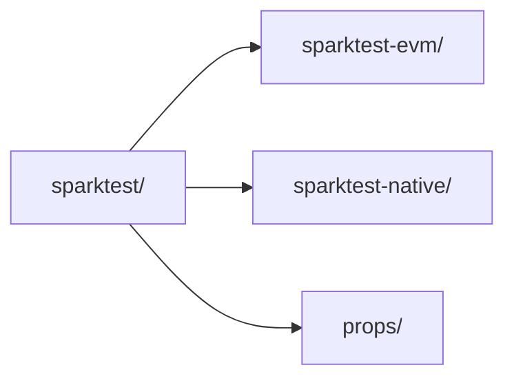
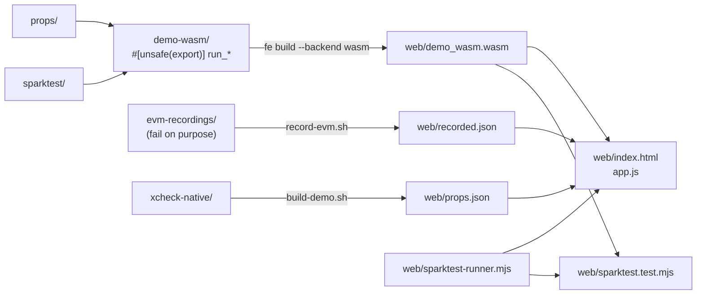

# Architecture

Sparktest is a set of Fe ingots. One ingot is the library; the others adapt it to a backend, hold properties, or test and demonstrate it. Ingot names use underscores (`sparktest_evm`); directories use hyphens (`sparktest-evm/`), because Fe 26.7.0 rejects hyphens in ingot names (`Invalid ingot name "qc-evm"`).

## The library

| ingot | role | effects |
|---|---|---|
| `sparktest/` | the core: `Rng` and `Xorshift`, the `Arbitrary`, `Shrink` and `Encode` traits, generators for integers, `bool`, `Address`, tuples, arrays, `Index<N>` and `Seq<C, N>`, `Config`, `Outcome`, `check`, the checked helpers, `Summary` and `Full`, the vacuity guards (`Tally`, `vacuity`, `Verdict`, `guard`) and the `Decode` trait | none |
| `sparktest-evm/` | EVM shim: `assert_holds` (reverts with `PropertyFailed`), `runtime_seed`, `fixed_seed` | `Evm` |
| `sparktest-native/` | native shim: `assert_holds` (prints, then fails), `opaque_zero`, `fixed_seed`, `ticks`, `print_summary`, `print_full` | `Stdout` |

The split exists because a test's entry effect is `Evm` on sonatina and `Host` on native; a file that asks for the other backend's effect does not compile (`error[8-0153]: unsupported entry effect`). So the core stays effect-free and runs everywhere, and each shim is a thin layer. `check` itself is `uses P::E`: it forwards whatever effects the property needs (for example `Evm` for a property that calls a contract) to its caller.

## How one `check` runs

1. `Xorshift::seeded(cfg.seed)` gives a deterministic stream (64-bit xorshift; the same seed gives the same stream on every backend).
2. For each of `cfg.cases` cases, `<T as Arbitrary>::arbitrary` draws an input (edge values about 1 draw in 4).
3. The property runs. On the first `false`, shrinking starts: `shrink_step(cur, 0), shrink_step(cur, 1), ...` until a candidate still fails; that candidate becomes `cur`; repeat until no candidate fails or `cfg.max_shrinks` steps were accepted.
4. The result is `Outcome::Pass { cases }` or `Outcome::Fail { original, shrunk, case, seed, steps }`.

Composite shrinkers shrink one component at a time, which is why coupled components can stop at a local minimum. `Seq<C, N>` tries halving the length, then dropping one command, then shrinking single commands.

## Properties and tests

| ingot | role | backend |
|---|---|---|
| `props/` | plain, effect-free property functions and planted-bug examples (`bugs.fe`, `stdprops.fe`, `demo.fe`, `stateful.fe`), plus generated proof scenarios | none |
| `tests-evm/` | unit and property tests, proof scenarios that emit events, cross-check scenarios | sonatina |
| `tests-native/` | the same properties on the native backend (`target = "native"`) | native |
| `tests-erc20/` | the ERC20 test fixture through contract calls: four actor proxy contracts, properties, stateful runs | sonatina |
| `tests-coolcoin/` | the Fe Guide's ERC-20 (`examples/coolcoin`, vendored unchanged) and its ten mutants (`examples/coolcoin-mutants`, generated by `scripts/gen_mutants.py`): properties, stateful run, probes | sonatina |
| `erc20-actors/` | actor proxy contracts and typed client helpers shared by the ERC20 test ingots | sonatina |
| `tests-isolated/` | panic recovery on sonatina: a harness contract and `check_isolated` for properties that panic | sonatina |
| `replay-native/` | the native replay driver (`run`, `gen`, `eval`, `cand` commands) used by `scripts/find-panic.sh` to bisect to the first aborting case and shrink by replay | native |
| `tests-rewards/` | a contract that panics, checked through `try_call` and through a direct call | sonatina |
| `examples/` | `erc20/` (vendored unchanged), `erc20-buggy/` and `erc20-stateful-bug/` (planted bugs), `rewards/`, `quickstart/` (a standalone ingot that depends on Sparktest) | sonatina |
| `spike/` | the feasibility spikes written before the library, kept as evidence | |

Backends cannot share a test file, so each backend has its own test ingot, all depending on `props/`. Properties are written once in `props/` and run on both.

## Demo and proof pipeline

- `demo-wasm/` exports scalar-only functions (`run_<name>(seed, cases, max_shrinks) -> bool`) and reports results through JavaScript callbacks (`st_pass`, `st_fail`, and `st_word` / `st_fail_seq` for sequences). The page raises `max_shrinks` 0, 1, 2, ... to animate the shrink.
- `web/` is static (no framework, no build step, relative paths). `sparktest-runner.mjs` is used by both the page and the Node test, which asserts that wasm, native and EVM give the same shrunk value for the same seed.
- `evm-recordings/` holds tests that fail on purpose so the runner prints real revert data; `scripts/record-evm.sh` decodes it with `tools/decode-revert` into `web/recorded.json`.
- `scripts/proof.sh` runs the proof suites on both backends (and ERC20 and rewards on sonatina) and generates [PROOF.md](PROOF.md) from `proof/registry.json` and `proof/stateful.json`; expected minimums are in [EXPECTATIONS.md](EXPECTATIONS.md), committed before the runs.

## Generated code

`sparktest/src/widths.fe`, `composite.fe` and `checked.fe`, `props/src/proof_scenarios.fe`, `tests-evm/src/proof.fe`, `proof-native/src/lib.fe` and four files in `tests-erc20/src/` are generated by `scripts/gen_*.py`. The freshness part of `scripts/test-all.sh` regenerates them and fails on any difference, so they cannot drift.

## Checks

`./scripts/test-all.sh` runs every suite, the revert decoder tests, the sonatina-vs-native cross-check, the documentation check (README excerpts verbatim from `examples/quickstart`; every example in [API.md](API.md) compiled), the proof check, the demo build and test, the EVM recordings check and the freshness check. It exits non-zero if any part fails.
